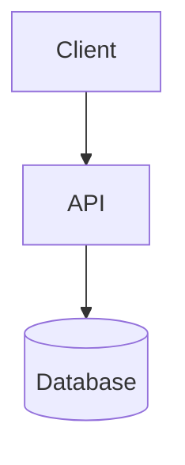
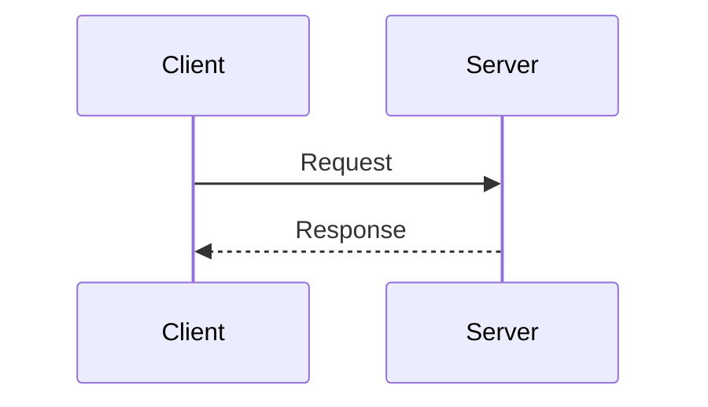
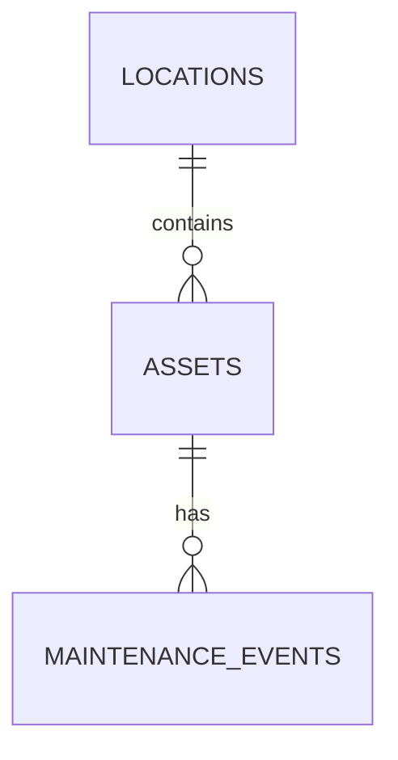

# repo-wiki format specification

Source of truth for `wiki/` layout, page content, mermaid usage, metadata
shape, and the HTML renderer. Keep wikis produced by this skill consistent
across runs and across repos.

## On-disk layout

```
wiki/
  01-overview.md
  02-architecture.md
  03-integration.md
  04-db-schema.md        (omit entirely if the repo has no database)
  05-technology.md
  06-other.md             (omit unless real content doesn't fit 01-05)
  feature/
    <slug>.md              (kebab-case, one file per feature, no numbering)
  .wiki-meta.json
```

Numbering never shifts to fill a gap - `06-other.md` can exist while
`04-db-schema.md` doesn't.

## `wiki/.wiki-meta.json`

```json
{
  "updatedAt": "2026-07-10T13:05:00.000Z",
  "command": "generate | update | feature",
  "gitHead": "<full HEAD commit SHA, empty string if not a git repo>",
  "model": "claude-sonnet-5"
}
```

Get `updatedAt` from the shell (`date -u +%Y-%m-%dT%H:%M:%S.000Z` on
bash, or `Get-Date` equivalent on PowerShell) - never guess the time.

## Page content

Each page starts with an H1 matching its purpose, then prose organized
under `##` headings. Ground claims in evidence; use inline references like
`` `src/database.py` lines 14-57 `` where they help a reader verify or
continue. Prefer linking to the one canonical page for a concept over
repeating it.

### 01-overview.md

- What the repo is and does, in plain terms.
- Tech stack summary (languages, frameworks, datastore) - one paragraph,
  not the full detail (that's `05-technology.md`).
- How to run it locally (pull from existing README/setup docs if present;
  don't invent commands).
- Links to every other page that exists, including `feature/`.

### 02-architecture.md

- Components/layers and what each does, as a table or list with file
  paths.
- One mermaid `graph TD` (or `flowchart TD`) showing how components/layers
  connect and data flows between them.
- Key conventions that cut across the codebase (naming patterns, shared
  helpers, request lifecycle).

### 03-integration.md

- Every real external integration: other services this repo calls, MCP
  servers it exposes or wraps, third-party APIs, CI/CD pipelines that call
  out to external tools, webhooks. Omit this page's content (fold into
  `06-other.md` or drop) if the repo has none.
- One mermaid `sequenceDiagram` per distinct integration flow.

### 04-db-schema.md

- Every table/collection: columns, types, constraints, relationships.
- One mermaid `erDiagram` covering the whole schema (or one per bounded
  context if the schema is large).
- Migration/seed strategy if one exists.

### 05-technology.md

- Language + runtime versions (from package manifests, not guessed).
- Key dependencies and why they're there (skip exhaustive lockfile dumps -
  call out the ones that shape the architecture).
- Dev tooling: test runner, linters, formatters, CI.

### 06-other.md

Only for real content that doesn't belong on 01-05: testing philosophy
beyond tooling, deployment/ops, training/onboarding material, security
notes. Never create this page empty or as a stub with one throwaway line.

### feature/<slug>.md

- What the feature does, for whom, why it exists (if the "why" is
  recoverable from commits/docs - don't invent motivation).
- Where it lives in source (entrypoint, key files, tests).
- A mermaid diagram (`sequenceDiagram` or `graph TD`, whichever fits) only
  if it genuinely clarifies the flow - not mandatory for every feature.
- Link back to `../02-architecture.md` / `../04-db-schema.md` instead of
  repeating shared context.

## Mermaid syntax quick reference

Fenced code blocks with the `mermaid` language tag render automatically
once passed through `scripts/render_html.py`:

````markdown

````





Keep diagrams small and legible (a handful of nodes/participants) - split
into more than one diagram rather than cramming everything into one.

## HTML renderer (`scripts/render_html.py`)

Two modes, always explicit, never run without the user asking:

```bash
# Static export: writes wiki-html/ once, mirrors wiki/ + wiki/feature/
python scripts/render_html.py --export --source wiki --out wiki-html

# Live server: renders each .md on request, always reflects current wiki/
python scripts/render_html.py --serve --source wiki --port 8765
```

- Installs the `markdown` package on first use if missing (same
  install-on-`ImportError` pattern as this repo's
  `.github/scripts/pr_review_agent.py`).
- Sidebar nav lists every root page in numeric order, then a "Features"
  group listing everything under `feature/`.
- Mermaid code blocks are converted to `<pre class="mermaid">...</pre>`
  and rendered client-side by the vendored `assets/mermaid.min.js` (no
  CDN, works offline).
- `--export` output should be added to the repo's `.gitignore` by the
  skill after first export (it's generated, not source) unless an entry
  already covers it.

## Security & privacy

- Never read or document secret values, credentials, private keys, tokens,
  or `.env` files. `.env.example`/sample configs are fine to mention by
  name only, with placeholders noted as placeholders.
- Keep all documentation under `wiki/` (source) and `wiki-html/`
  (generated export). Never modify files outside those two directories.
